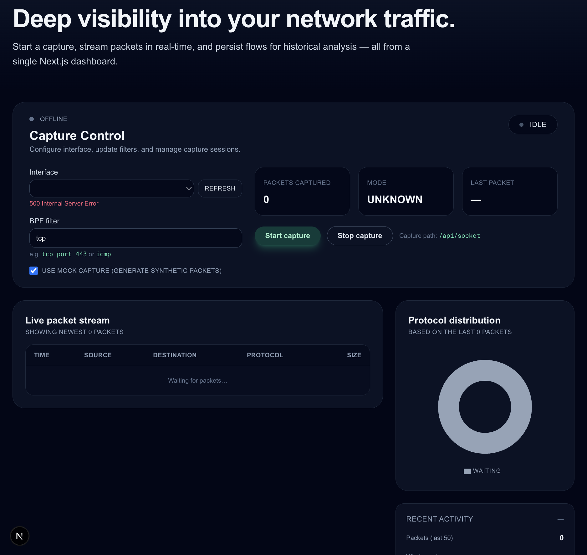

# Packly

**Live demo:** [https://packly-gold.vercel.app](https://packly-gold.vercel.app)

**v2 in `4) Security`:** keep the v1 dashboard, add a **diagnostic report** from decoded packets (protocol counts, port-spread, RST burst, SYN volume). Mock capture is the default demo. Sample / uploaded PCAP playback does not need Npcap.

On Windows: `npm install` may warn that optional `cap` failed to compile. Ignore it. Use **Use mock capture** or **Play sample PCAP**. Npcap + Python are only required for live NIC sniffing.

### Vercel vs local / Docker

The **web UI** (landing, dashboard, history, PCAP playback, diagnostic export) deploys to Vercel. **Live NIC capture** needs a long-lived Node process with libpcap/Npcap privileges — that path runs **locally or via Docker Compose**, not on serverless. On Vercel you can still demo history/dashboard UI and file-based playback; set `PACKLY_API_KEY` to protect start/stop/history.

Build list: [`TODO.md`](./TODO.md).


<div align="center">


</div>

<div align="center">

## 🚀 Development Status


## 🌐 Connect With Me

[](https://www.linkedin.com/in/pierre-mvita/)
[](https://pierre-mvita.vercel.app/)
[](mailto:Petermvita@hotmail.com)

## 💻 Core Framework


## 💾 Database & ORM


## 🔌 Networking & Communication


## 📊 Monitoring & Observability


## 🧪 Testing & Quality


## 🐳 DevOps


</div>

**Live (UI preview):** [https://packly-gold.vercel.app](https://packly-gold.vercel.app)

Packly is a full-stack packet inspector: capture frames with libpcap, decode protocol stacks, persist flows in PostgreSQL, and visualise everything from a Next.js dashboard. Capture utilities, APIs, background jobs, and UI all live in one codebase so you can iterate quickly and still deploy with confidence.

## Design

Packly uses a dark phosphor radar ops aesthetic:

| Token | Value |
|-------|-------|
| Display / brand | **Syne** (`next/font/google`) |
| Tables / data | **IBM Plex Mono** |
| `--ink` | `#071210` |
| `--panel` | `#0E1A18` |
| `--surface` | `#132420` |
| `--phosphor` | `#3DFFC8` |
| `--warn` | `#F0A202` |
| `--signal` | `#FF5C5C` |
| `--fog` | `#A8C5BC` |
| `--line` | `rgba(61,255,200,0.14)` |

Motion: live status pulse on capture indicators, staggered row fade-in on packet/history tables, phosphor underline/hover on nav links (respects `prefers-reduced-motion`).

**Refs:** [21st.dev](https://21st.dev) Streaming Data Rows / InlineAnalyticsTable pattern inspiration (dense live tables); [Context.dev](https://context.dev) linear.app density/spacing rhythm (not Inter fonts). **Mobbin:** unavailable (paid plan) — no Mobbin refs applied.

## Architecture note

Packly is a **web app + server-side capture engine**, not a desktop app. The browser only renders results; packet sniffing runs in the Node process on the host (which needs NIC privileges). **Full capture needs Docker/VM with NIC privileges** — not a serverless-only host. A marketing/UI preview may deploy to Vercel (`https://packly-gold.vercel.app`), but live sniffing, Socket.IO capture, and Postgres persistence are intended for Docker Compose (see below).

## Highlights

- **Real-time capture pipeline** powered by `cap`, `Socket.IO`, and a resilient capture manager with mock fallback for development.
- **PostgreSQL persistence** with Prisma models for sessions, packets, flows, and background rollups that summarise recent activity.
- **Rich dashboard** built with Next.js App Router, React Query, Zustand, and Recharts for packet tables, protocol breakdowns, and live metrics.
- **Observability baked-in**: structured Pino logging, Prometheus-compatible metrics (`/api/metrics`), and scheduled summarisation jobs.
- **Quality gates**: Vitest + Testing Library suites, ESLint, and a GitHub Actions workflow that runs linting and tests on every push/PR.
- **Deployment-ready**: Dockerfile and `docker-compose.yml` for running the app alongside PostgreSQL (with packet capture capabilities enabled).

See `docs/architecture.md` for component responsibilities and data-flow diagrams.

## Screenshots


<!-- Add screenshots of the dashboard, packet tables, protocol breakdowns, etc. -->
<!-- Example format:


-->

## Prerequisites

| Requirement | Notes |
|-------------|-------|
| **Node.js 20+** | Development and CI use Node 20. |
| **npm** | Included with Node (lockfile is `package-lock.json`). |
| **libpcap / Npcap** | **Optional.** Live NIC capture uses the `cap` binding. Windows demo path is mock packets or a `.pcap` file. macOS: `brew install libpcap`. Ubuntu/Debian: `sudo apt-get install libpcap-dev`. |
| **Packet capture privileges** | Only for live sniffing. macOS: `sudo dseditgroup -o edit -a $(whoami) -t user access_bpf` then log out/in. Linux: `CAP_NET_ADMIN`. |

## Quick start

```bash
# 1. Install dependencies
npm install

# 2. Copy environment template and edit it
cp .env.example .env.local

# 3. Run migrations (requires DATABASE_URL)
npm run prisma:migrate -- --name init

# 4. Generate Prisma client + start the dev server
npm run prisma:generate
npm run dev
```

Visit [http://localhost:3000](http://localhost:3000). **Use mock capture** is on by default. Start a session, then **Export report** for markdown findings, or **Play sample PCAP** / **Open PCAP** to decode a file without Npcap.

## Environment variables

Copy the template — do **not** commit secrets:

```bash
cp .env.example .env.local
```

| Variable | Required | Purpose |
|----------|----------|---------|
| `DATABASE_URL` | Yes (persistence) | PostgreSQL connection string. |
| `CAPTURE_INTERFACE` | No | Default NIC when the UI first loads (e.g. `en0`, `eth0`). |
| `CAPTURE_FILTER` | No | Default BPF filter (`tcp`, `tcp port 80`, etc.). |
| `CAPTURE_PROMISCUOUS` | No | Promiscuous mode (default `true`). |
| `PACKLY_CAPTURE_FALLBACK_TO_MOCK` | No | Fall back to mock when live capture fails (default `true`). |
| `SUMMARY_ROLLUP_INTERVAL_MINUTES` | No | Background traffic summary interval. |
| `PACKET_TTL_DAYS` | No | Delete persisted packets older than N days (default `30`). |
| `PACKET_TTL_CLEANUP_INTERVAL_HOURS` | No | How often the TTL job runs (default `6`). |
| `PACKLY_API_KEY` | Optional | When set, required for start/stop/history via `X-API-Key` or `Authorization: Bearer`. |
| `SOCKET_IO_PATH` / `NEXT_PUBLIC_SOCKET_PATH` | No | Socket.IO handshake path (defaults to `/api/socket`). |
| `NEXT_PUBLIC_DEFAULT_INTERFACE`, `NEXT_PUBLIC_DEFAULT_FILTER` | No | Client defaults for the dashboard. |

### Vercel (UI preview only)

Project is linked (`.vercel/`). A marketing/UI preview can ship to Vercel, but:

- Live NIC capture, Socket.IO capture sessions, and Prisma persistence need a host with Postgres + privileges (Docker Compose / VM) — **not** serverless-only.
- Set env in the Vercel dashboard from `.env.example` keys; leave `PACKLY_API_KEY` empty unless you intentionally gate the preview APIs.
- Prefer mock / sample PCAP modes on the preview deploy. Do not expect `DATABASE_URL` or Npcap to work on the free Vercel runtime without an external DB + long-running process.

## Key commands

| Command | Description |
|---------|-------------|
| `npm run dev` | Start Next.js in development mode. |
| `npm run build` / `npm run start` | Production build and runtime. |
| `npm run lint` | ESLint via `next lint`. |
| `npm run test` / `npm run test:watch` | Vitest suites (Node environment by default). |
| `npm run coverage` | Generate lcov + text coverage reports. |
| `npm run prisma:migrate -- --name <msg>` | Apply migrations to the configured database. |
| `npm run prisma:generate` | Regenerate the Prisma client (`src/generated/prisma`). |

GitHub Actions (`.github/workflows/ci.yml`) runs `npm run lint` and `npm run test` on pushes and pull requests targeting `main`/`master`.

## API surface

| Endpoint | Method | Description |
|----------|--------|-------------|
| `/api/capture/interfaces` | `GET` | Enumerate capture-capable network interfaces. |
| `/api/capture/status` | `GET` | Current capture manager state & metrics. |
| `/api/capture/start` | `POST` | Start a capture session (`device`, `filter`, `useMock`, etc.). Auth when configured; rate-limited (5/min). |
| `/api/capture/stop` | `POST` | Stop the running capture session (auth when configured). |
| `/api/capture/history` | `GET` | List recent capture sessions (scoped by API key ownership when present). |
| `/api/capture/history/:id` | `GET` | Session detail with flows + up to 200 packets. |
| `/api/capture/auth-status` | `GET` | Whether `PACKLY_API_KEY` is configured (`required: boolean`). |
| `/api/capture/playback` | `GET` | Bundled scan-like sample → packets + diagnostic markdown. |
| `/api/capture/playback` | `POST` | Upload Ethernet `.pcap` / `.pcapng` (2 MB max). |
| `/api/socket` | `Socket.IO` | Realtime stream (status + packets + errors). |
| `/api/metrics` | `GET` | Prometheus metrics (Pino logs note status transitions). |

Socket event names: `capture:status`, `capture:packet`, `capture:error`, plus `capture:start` / `capture:stop` client emissions for control.

## Observability & background jobs

- **Logging** uses `pino` with service metadata; messages originate from the capture manager, persistence coordinator, and summary scheduler.
- **Metrics** powered by `prom-client`: total packets, packet size histogram, and capture status gauges.
- **Summary scheduler** (`src/server/background/summary-scheduler.ts`) runs every `SUMMARY_ROLLUP_INTERVAL_MINUTES` to persist rollups via Prisma (top talkers, protocol breakdowns).
- **Packet TTL scheduler** (`src/server/background/packet-ttl-scheduler.ts`) clears raw payloads after 24h and deletes packets older than `PACKET_TTL_DAYS`.

Expose `/api/metrics` to your Prometheus or use Docker compose to bind it to your monitoring stack.

## Docker & Compose

```bash
# Build the production image
docker build -t packly .

# Or run with Postgres using compose (requires root or NET_ADMIN capability)
docker compose up --build
```

`docker-compose.yml` provisions:

- `app`: Packly (port 3000) with `cap_add: NET_ADMIN` so libpcap can access the host NICs.
- `db`: PostgreSQL 16 with health checks and a persistent volume (`postgres-data`).

Provide a `.env.local` file (referenced via `env_file`) or override variables inline.

## Project structure

```
app/                 # Next.js App Router pages & API endpoints
docs/                # Architecture reference
prisma/              # Prisma schema & migrations
src/
  capture/           # cap wrappers, session manager, parsers, mocks
  db/                # Prisma client + repositories
  features/          # UI feature modules (live dashboard)
  observability/     # Logger, metrics registry
  server/            # Capture manager, persistence, background jobs
tests/               # Vitest suites
```

## 📊 GitHub Stats

<div align="center">


</div>

## Roadmap snapshot

- [x] Capture utilities with fallback mock mode.
- [x] Live Socket.IO stream & REST control plane.
- [x] Prisma schema + repositories + background summaries.
- [x] Dashboard (tables, charts, rate metrics).
- [x] Metrics, logging, Prometheus-exporting endpoint.
- [x] Vitest suites + CI pipeline.
- [x] Dockerfile & Compose setup.
- [x] Diagnostic markdown report (port-spread / RST / SYN).
- [x] Sample + uploaded PCAP playback (classic pcap, Ethernet).
- [x] Historical queries against PostgreSQL (`/history` + `/api/capture/history`).
- [x] Optional API-key auth + ownership scoping (`PACKLY_API_KEY`).
- [x] Packet TTL cleanup job (`PACKET_TTL_DAYS`).
- [ ] Alerting rules & webhook integrations.

Refer to `packet.plan.md` for the full implementation roadmap.
